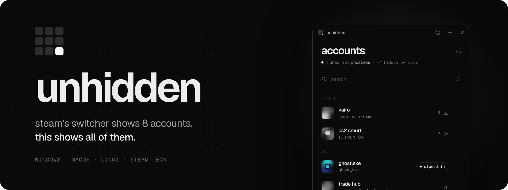
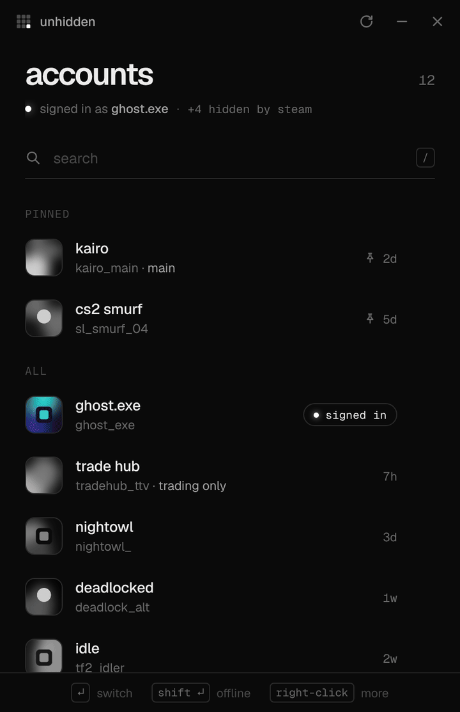
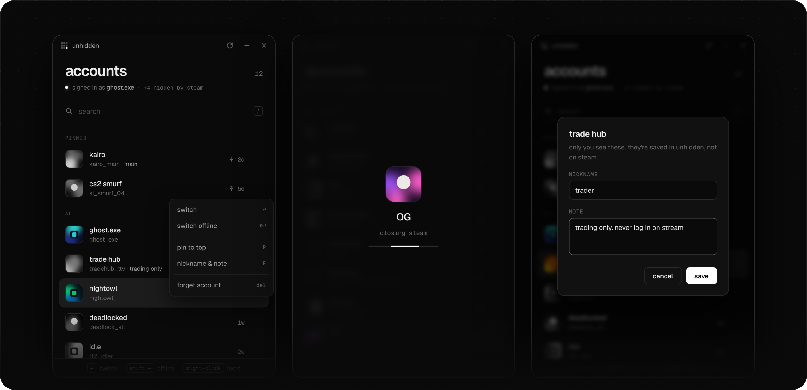

<p align="center">
  
</p>

<p align="center">
  <a href="https://github.com/Kh8da/unhidden/releases/latest"><b>Download</b></a>
  &nbsp;·&nbsp;
  <a href="#how-it-works">How it works</a>
  &nbsp;·&nbsp;
  <a href="#faq">FAQ</a>
  &nbsp;·&nbsp;
  <a href="#build">Build</a>
</p>

<br>

Steam's account switcher stops at eight. Sign in to a ninth and one of the others drops off the list. It's still
saved on your PC, sign-in and all; Steam just won't show it until you log out of something else.

**unhidden** lists every account Steam has saved and switches to any of them in one click. No passwords, no
logging out, nothing to install.

<p align="center">
  
</p>

## Download

| Platform | File | |
|---|---|---|
| Windows 10 / 11 | [`Unhidden-windows-x64.exe`](https://github.com/Kh8da/unhidden/releases/latest/download/Unhidden-windows-x64.exe) | Single file, nothing to install |
| macOS 11+ | [`Unhidden-macos.dmg`](https://github.com/Kh8da/unhidden/releases/latest/download/Unhidden-macos.dmg) | Apple Silicon and Intel |
| Linux, Steam Deck | [`Unhidden-linux-x86_64.AppImage`](https://github.com/Kh8da/unhidden/releases/latest/download/Unhidden-linux-x86_64.AppImage) | Any distro |
| Ubuntu, Debian, Mint | [`Unhidden-linux-amd64.deb`](https://github.com/Kh8da/unhidden/releases/latest/download/Unhidden-linux-amd64.deb) | |

The builds aren't code-signed, so each system asks once on first launch:

<details>
<summary><b>Windows</b>: "Windows protected your PC"</summary>
<br>
Click <b>More info</b>, then <b>Run anyway</b>. Windows remembers the choice.
</details>

<details>
<summary><b>macOS</b>: "can't be opened"</summary>
<br>
Drag Unhidden into Applications, right-click it and choose <b>Open</b>. On macOS 15 and later, try to open it once,
then go to System Settings → Privacy &amp; Security and click <b>Open Anyway</b>.
</details>

<details>
<summary><b>Linux and Steam Deck</b>: AppImage won't open</summary>
<br>
Right-click it → Properties → Permissions → allow executing (or <code>chmod +x Unhidden-linux-x86_64.AppImage</code>),
then double-click it. On Steam Deck, do this in Desktop Mode.
</details>

## Features

<p align="center">
  
</p>

- **Every account.** Reads the full list Steam keeps on disk, not the eight its switcher shows. The header
  tells you how many Steam is hiding.
- **One click to switch.** unhidden closes Steam, points it at the account you picked and opens it again, signed in.
  Shift-click to start in offline mode.
- **Knows who's who.** Profile pictures, Steam names, login names and when each account last signed in.
  The one you're on is marked.
- **Pin, nickname, note.** Keep your main at the top, call the smurf "cs2 smurf", write down which one is for
  trading. These stay in unhidden; Steam never sees them.
- **Search.** Start typing anywhere. It matches Steam names, login names, nicknames and notes.
- **Forget.** Removes an account from Steam's saved list on this PC, after asking.
- **Small and quiet.** 3.5 MB on Windows. No installer, no background process, no network access, no telemetry.

### Keyboard

| Key | Does |
|---|---|
| <kbd>↑</kbd> <kbd>↓</kbd> | Move through the list |
| <kbd>Enter</kbd> | Switch |
| <kbd>Shift</kbd> <kbd>Enter</kbd> | Switch in offline mode |
| Type anything, <kbd>/</kbd> or <kbd>Ctrl</kbd> <kbd>F</kbd> | Search |
| <kbd>P</kbd> | Pin or unpin |
| <kbd>E</kbd> | Nickname and note |
| <kbd>Del</kbd> | Forget |
| <kbd>F5</kbd> | Refresh |
| <kbd>Esc</kbd> | Clear the search, close a menu |
| Right-click, <kbd>Shift</kbd> <kbd>F10</kbd> | All options for an account |

## How it works

Every account you've signed in to with "Remember me" is listed in Steam's `config/loginusers.vdf`, and Steam keeps
its saved sign-in. The switcher only ever shows eight of them. When you pick one, unhidden:

1. Asks Steam to close and waits for it to save its files. If Steam hangs, it's closed after 15 seconds.
2. Marks that account as the one to sign in to, in `loginusers.vdf` and in Steam's `AutoLoginUser` setting.
3. Turns off Steam's *Ask which account to use each time Steam starts*. While that's on, Steam ignores the
   auto-login and shows its own picker, which is the one with the eight-account limit.
4. Starts Steam, which signs straight in.

It never sees, asks for or stores a password. If Steam has expired an account's saved sign-in, Steam itself asks
for that password, and the account is back to one click after you sign in with "Remember me" ticked.

| | Windows | Linux, Steam Deck | macOS |
|---|---|---|---|
| Steam folder | From the registry | `~/.local/share/Steam`, plus Flatpak, Snap and Debian layouts | `~/Library/Application Support/Steam` |
| `AutoLoginUser` | `HKCU\Software\Valve\Steam` | `~/.steam/registry.vdf` | `registry.vdf` in the Steam folder |
| Closing Steam | `steam.exe -shutdown` | `SIGTERM`, then `SIGKILL` | `SIGTERM`, then `SIGKILL` |
| Starting Steam | `steam.exe` | `steam`, `flatpak run` or `snap run` | `open -a Steam` |

### Careful by design

- Steam isn't closed until every file it's about to change has been read and checked. If anything looks wrong,
  nothing happens and you're told why.
- Before a file is changed, the previous version is copied next to it as `<file>.unhidden-backup`. The new
  version replaces it in one step, so a crash can't leave Steam with a half-written file.
- A file unhidden can't fully read is left exactly as it was. It never guesses.
- In `config.vdf`, only that one setting is changed. Every other byte stays the same.

## FAQ

<details>
<summary><b>Can this get my account banned?</b></summary>
<br>
unhidden doesn't touch games, game files or anything that's running. It edits the same sign-in settings Steam
changes when you tick "Remember me" and switch accounts yourself, the same way long-standing switchers like TcNo
do. It isn't made or endorsed by Valve, though.
</details>

<details>
<summary><b>Steam asked for a password.</b></summary>
<br>
Steam had expired that account's saved sign-in, which happens after a password change, a long break or
"Deauthorize all devices". Sign in once with "Remember me" ticked and it's back to one click.
</details>

<details>
<summary><b>Steam asked to install or repair "Steam Service".</b></summary>
<br>
That's Steam's own one-time repair of its background service. It can show up after Steam updates itself during
a restart. It's safe to accept when the Windows prompt names Valve Corporation as the publisher. unhidden never
touches the service.
</details>

<details>
<summary><b>Does it work on Steam Deck?</b></summary>
<br>
Yes, from Desktop Mode. In Game Mode, Steam is the whole session, so closing it would close unhidden too before
it could finish. unhidden notices and tells you instead of starting a switch it can't complete.
</details>

<details>
<summary><b>Flatpak or Snap Steam?</b></summary>
<br>
Both are found automatically, along with the regular and Debian installs. If your Steam lives somewhere else,
unhidden asks you to point at the folder once.
</details>

<details>
<summary><b>Where are my pins, nicknames and notes?</b></summary>
<br>
In unhidden's own settings file, never in Steam's:
<br><br>
Windows: <code>%APPDATA%\app.unhidden.switcher\settings.json</code><br>
Linux: <code>~/.config/app.unhidden.switcher/settings.json</code><br>
macOS: <code>~/Library/Application Support/app.unhidden.switcher/settings.json</code>
</details>

<details>
<summary><b>How do I undo a change?</b></summary>
<br>
Close Steam, then rename <code>loginusers.vdf.unhidden-backup</code> (in Steam's <code>config</code> folder) back to
<code>loginusers.vdf</code>. The same works for <code>config.vdf</code> and <code>registry.vdf</code>.
</details>

## Build

You need [Rust](https://rustup.rs) and [Node.js](https://nodejs.org) 20 or later.

```sh
npm install
npx tauri build              # macOS, Linux
npx tauri build --no-bundle  # Windows: a single Unhidden.exe
```

Linux also needs the WebKitGTK development packages:

```sh
sudo apt install libwebkit2gtk-4.1-dev libgtk-3-dev librsvg2-dev libsoup-3.0-dev patchelf
```

Every push runs [`build.yml`](.github/workflows/build.yml), which tests and builds all three platforms on real
Windows, Linux and macOS machines. Pushing a `v*` tag publishes a release.

### Tests

```sh
cargo test -p steamcore                                        # Steam's file formats
cargo build --release -p harness && ./target/release/harness   # end to end, fake Steam
```

`harness` runs the real switching code end to end against a fake Steam that quits when asked, saves its files on
the way out, and can be told to hang. On Linux it works inside a throwaway home folder. On Windows and macOS it
has to use the real Steam settings, so it only runs there with `--ci`, which is meant for a throwaway machine.

### Layout

```
steamcore/            Steam's file formats: VDF, loginusers.vdf, config.vdf, registry.vdf
src-tauri/src/steam/  Finding, closing and starting Steam (windows.rs, unix.rs)
src-tauri/src/        Switch and forget (actions.rs), the app shell (main.rs)
ui/                   The interface: plain HTML, CSS and JavaScript
harness/              End-to-end test and the fake Steam
```

Built with [Tauri](https://tauri.app). Set in [Geist](https://vercel.com/font).

## License

[MIT](LICENSE). The Geist font is under the [SIL Open Font License](ui/fonts/OFL.txt).

Not affiliated with Valve. Steam is a trademark of Valve Corporation.
